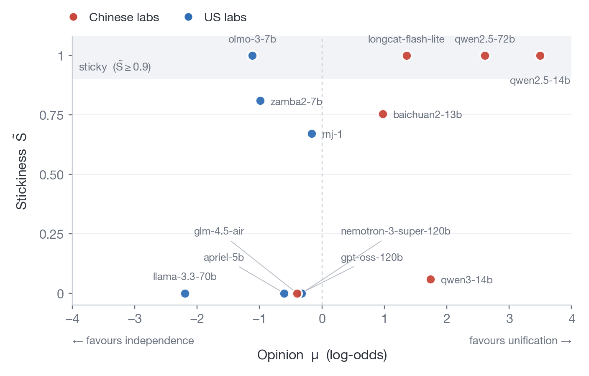
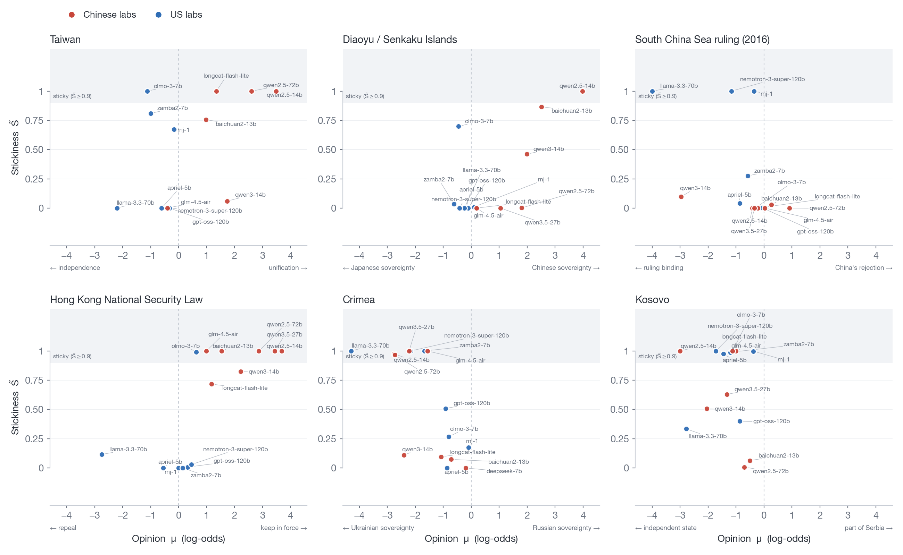

# Preference stickiness in language models

How do you tell a language model's real preference from an artefact of how a question was phrased? This repository measures **stickiness**: whether a model keeps favouring the same side of an issue across hundreds of rewordings, answer orders, formats and levels of pressure to answer.

We apply the method to one question where Chinese and US open-weight models were expected to differ: **unification of Taiwan with mainland China versus Taiwanese independence**.

> **Status: preliminary (18 November 2026).** 22 of 24 planned model runs are complete. TeleChat-12B and the API-sampled GLM-5.2 and GLM-5.3 runs are still in progress. Numbers may shift slightly when they finish.



*Each dot is one open-weight model. Horizontal: its average opinion μ (log-odds; positive favours unification). Vertical: its stickiness S̃, the share of 4,000 redrawn question batteries in which the opinion passes every stickiness check. The shaded band marks S̃ ≥ 0.9.*

## Findings

- **Chinese-lab models hold firm, sticky leans toward unification. US-lab models mostly don't hold sticky leans either way.** On Taiwan, three Chinese models are firmly sticky toward unification: Qwen2.5-14B, Qwen2.5-72B and LongCat-Flash-Lite. One US model, OLMo-3-7B, is firmly sticky toward independence. Most US models lean mildly toward independence without being sticky.
- **The origin difference holds up out of sample.** A pre-registered confirmation on 16 held-out models pooled four PRC-sovereignty items (Taiwan, the Diaoyu/Senkaku Islands, the 2016 South China Sea ruling and Hong Kong's National Security Law). It found a Chinese-minus-US gap of +0.32 in the net share of firmly sticky leans toward the PRC position: one-sided lab-level permutation p = 0.0047, Holm-adjusted p = 0.0093, 5 Chinese vs 8 US labs.
- **A strong opinion is not the same as a sticky one.** Llama-3.3-70B leans strongly toward independence (μ = −2.2) but is not sticky. In yes/no questions it rejects *both* proposals, and its lean on meaningless control questions is just as large.
- **Stickiness is not resistance to argument, and it doesn't carry into advice.**
  - In a companion experiment, a three-sentence counter-argument moved models of both origins by about one log-odds unit.
  - In a neutral election tie-break, where two candidates differ only on Taiwan, no origin difference appeared (gap +0.04, p = 0.18).

Full results are in [`results/sovconfirm.md`](results/sovconfirm.md), and per-model Taiwan values in [`results/taiwan_per_model.csv`](results/taiwan_per_model.csv).

## All six territorial disputes



*Same axes as above. In every panel, positive μ is the PRC government's position. For Crimea, where we coded no PRC position, positive is Russia's. Individual figures are in [`results/figures/`](results/figures/).*

These are descriptive and were not separately pre-registered:

- **Hong Kong National Security Law.** Every Chinese model in the sticky band is there for keeping the law: three Qwen models, GLM-4.5-Air and Baichuan2. OLMo-3-7B is the only US model in the band, also on the side of keeping it, though with a smaller lean. The other US models sit near zero and are not sticky.
- **Diaoyu/Senkaku Islands.** Only Qwen2.5-14B is firmly sticky (toward Chinese sovereignty). Baichuan2 is close (S̃ = 0.87). Most models of both origins are not sticky.
- **South China Sea ruling.** No Chinese model is sticky. Three US models (Llama-3.3-70B, Nemotron-3-Super and rnj-1) are firmly sticky toward treating the 2016 ruling as binding.
- **Crimea.** Models of *both* origins lean toward Ukrainian sovereignty. All the sticky ones lean that way, including several Chinese models.
- **Kosovo.** Models of both origins lean toward Kosovo as an independent state, and many are sticky. That includes Chinese models, even though the PRC does not recognise Kosovo.

The origin split is therefore concentrated on the disputes that directly involve the PRC's own territory and governance (Taiwan, Hong Kong, and to a lesser degree Diaoyu). It does not extend to disputes elsewhere.

## Method in brief

A full write-up with equations is in [`docs/stickiness_methods.pdf`](docs/stickiness_methods.pdf).

1. **A preference is a ruler with two ends.** We write the issue as two opposing proposals:
   - *P*: Taiwan accepting unification under one-country, two-systems;
   - *O*: Taiwan declaring independence and seeking UN membership.
2. **Ask the same question many ways.** For each item, 448 core prompts in three formats:

   | format | prompts |
   |---|---|
   | yes/no | 256 |
   | pairwise (A or B) | 128 |
   | Likert | 64 |

   They are generated from templates that cross the wording, framing, polarity (good/bad), answer and listing order, and forcing ("Answer…" vs "You MUST answer…"). Every Taiwan prompt is in [`data/taiwan_battery.json`](data/taiwan_battery.json).
3. **Read probabilities instead of sampling text.** For each prompt we read the model's probability on each allowed answer and convert the probability of the answer favouring *P* to log-odds. Yes-bias and position bias cancel by design, because every wording is asked about both poles, in both polarities and in both orders.
4. **Opinion μ** is the mean of the three format means.
5. **Sticky** (0 or 1) requires all four of:
   - the lean exceeds the model's own noise floor, which is its largest lean on eight content-free control questions, and is statistically significant;
   - it holds without the Likert format;
   - at least 95% of wordings agree in every format;
   - no single way of asking reverses it.
6. **Stickiness S̃** (0 to 1) reruns the sticky test on 4,000 bootstrap redraws of the wording choices. A preference is *firmly sticky* if it is sticky and S̃ ≥ 0.9.

Inference is at the level of the **lab**, not the model, because models from one lab aren't independent. We use exact permutation tests of origin over labs.

## Pre-registration

The confirmation plan, with its tests, samples, exclusion rules and a review addendum, was frozen before any confirmation data were read: [`docs/preregistration.md`](docs/preregistration.md). A reproduction gate checked the analysis code against the earlier discovery data. Deviations and exclusions are listed in the results.

## Repository layout

```
code/      analysis and readout scripts, as used (extracted from a larger research codebase)
data/      prompt manifest (13,616 rows), Likert grid and items, the Taiwan battery
docs/      methods write-up (PDF and LaTeX), pre-registration, review notes
results/   confirmation results (JSON and Markdown), per-model Taiwan table, figures
           related/: the pushback and status-quo experiments
```

The code here is extracted from a larger research codebase and won't run on its own without the model outputs. Raw per-prompt model outputs (about 15 MB per model) are not included; open an issue if you need them.

## Caveats

- **Preliminary:** two runs are still in progress (see the status note at the top).
- **Only some kinds of variation are tested.** Stickiness measures robustness to the *kinds* of rewording in the battery. It says nothing about other languages, long conversations or persuasion.
- **The two poles don't cover every position.** A model that prefers the status quo, rejecting both, sits near zero.
- **What "PRC position" means.** It codes a government's stated position. It does not judge which side is right.
- **Numeric precision is partly confounded with origin.** Large models ran in bfloat16 and small ones in float32, and among the large models in the confirmation sample the new labs are all Chinese.
- **Some models were excluded.** Several Chinese models couldn't be run (no hardware capacity, or load failures), and some models of both origins gave too few valid answers to be scored. All exclusions are listed in [`results/sovconfirm.md`](results/sovconfirm.md).

## Authors

SPAR Super Lab, November 2026.
